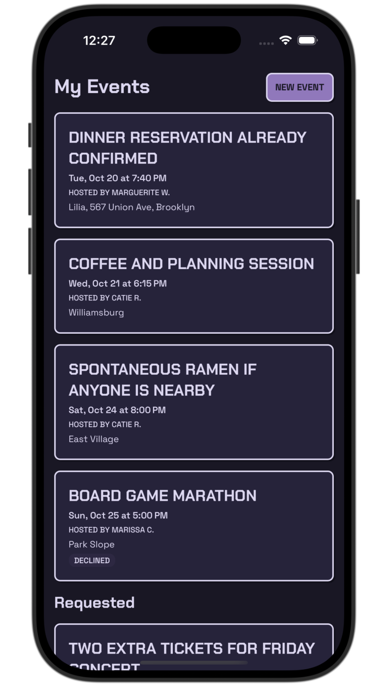
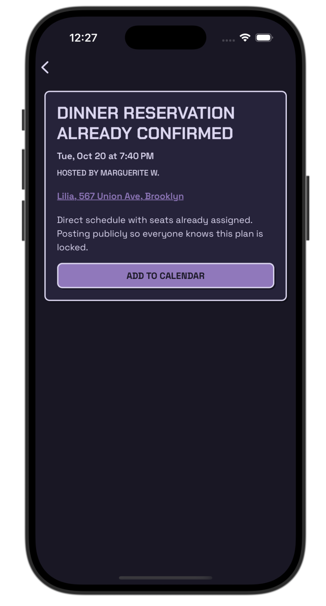
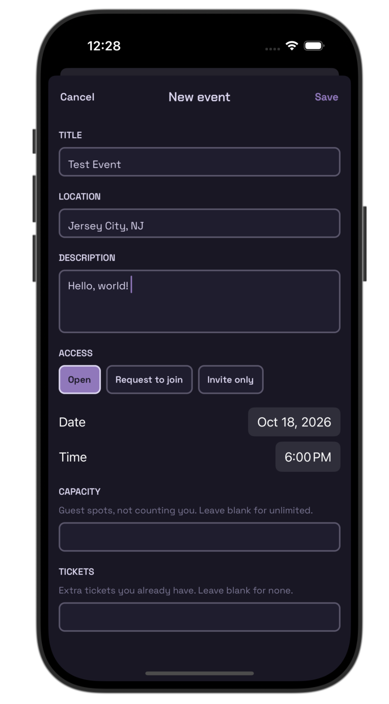

# LocalHost

An event planner for iOS and Android: create events, track the ones you're hosting or attending, and view event details. React Native port of the [LocalHost web app](https://github.com/crencricca/localhost).

<p>
  
  
  
</p>

## Run locally

Requires Node, plus Xcode (iOS) or Android Studio (Android).

```bash
npm install
npm run ios      # or: npm run android
```

This builds a development build and starts the dev server. After the first build, `npm start` is enough.

Lint and typecheck: `npm run lint && npm run typecheck`

## Software factory

Most features here were built by `/factory`, a [Claude Code](https://claude.com/claude-code) skill that runs a feature through a multi-agent pipeline:

1. **Spec**: a spec-writer drafts `spec.md`, then pauses for human review.
2. **Build**: a builder implements it in its own git worktree and branch.
3. **Review**: security, UX, UI and code reviewers run in parallel. On changes, the builder reworks (up to 2 rounds).
4. **Approve**: the job opens a PR, and an approver either squash-merges it once CI passes or escalates to a human.

Usage: `/factory <feature>`, or `/factory next` to take the next item in [`factory/backlog.md`](factory/backlog.md). [`factory/context.md`](factory/context.md) holds the domain rules and decisions every agent reads. Agents live in [`.claude/agents/`](.claude/agents/), the orchestrator in [`.claude/skills/factory/SKILL.md`](.claude/skills/factory/SKILL.md). Watch progress with `cd factory && python3 -m http.server --bind 127.0.0.1`, then open `/dashboard.html`.
